EDAwithR
================
John Tapia
2026-11-13

## **10.3.3 Exercises**

### **Exercise 1) Explore the distribution of each of the x, y, and z variables in diamonds**

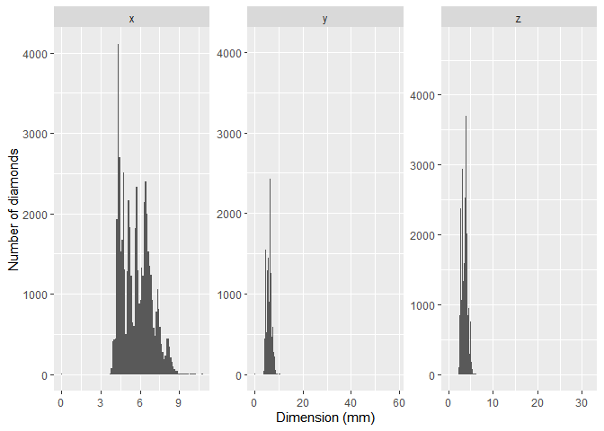<!-- -->

It seems like y and z have more extreme outliers to the right of its distribution while x has some outlier/s to th left of its distribution.

I now used coor_cartesian in order to get a better look at the distributions shape

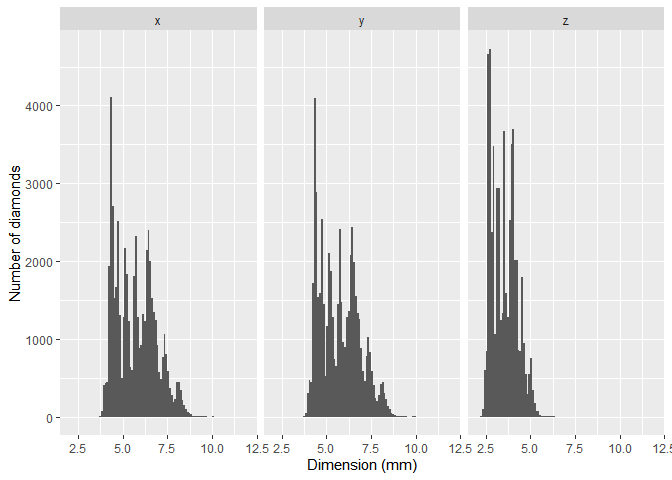<!-- -->

### **What do you learn? Think about a diamond and how you might decide which dimension is the length, width, and depth.**

The distribution of x and y look similar. Most measurements fall between 4 and 8 mm and have many peaks. The z measurements are smaller, most being between 2.5 and 5 mm. I would argue that x and y, looking from above, are the length and width of the diamond. The z measurement is most likely the dept as a diamonds depth does not tend to usually be bigger than the other measurements.

### **Exercise 2) Explore the distribution of price.**

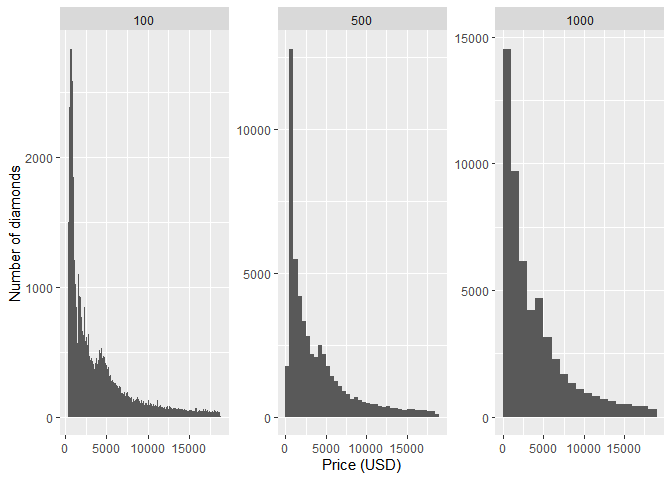<!-- -->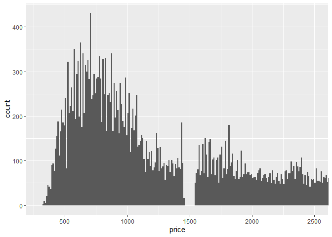<!-- -->

### **Do you discover anything unusual or surprising? (Hint: Carefully think about the binwidth and make sure you try a wide range of values.)**

I tested the binwidth 100,500 and 1000. Diamond prices are strongly right skewed. Most diamonds are concentrated around the lower price range, possibly lower than \$2000. It can be hard to see so I created another plot that really zooms in and uses binwidth of 10. It seems most diamonds fall between \$ 500 and \$1000, the most are somewhere in between. The spikes and dips are more apparent with a bin of 10 using coord_cartesian. One unusual thing is that there are no prices around the \$1500 range, completely empty.

### **Exercise 3) How many diamonds are 0.99 carat? How many are 1 carat? What do you think is the cause of the difference?**

Based off the number of rows in each table below, there are 23 diamonds that are 0.99 carat and 1558 diamonds that are 1 carat. Looking at the prices alongside the columns shows that there may be more demand for 1 carat diamonds then 0.99. They go for more so they would probably stock more 1 carat then 0.99.

    ## # A tibble: 23 × 2
    ##    price carat
    ##    <int> <dbl>
    ##  1  2811  0.99
    ##  2  2812  0.99
    ##  3  2949  0.99
    ##  4  3337  0.99
    ##  5  3593  0.99
    ##  6  4002  0.99
    ##  7  4052  0.99
    ##  8  4075  0.99
    ##  9  4763  0.99
    ## 10  4780  0.99
    ## # ℹ 13 more rows

    ## # A tibble: 1,558 × 2
    ##    price carat
    ##    <int> <dbl>
    ##  1  2795     1
    ##  2  2801     1
    ##  3  2808     1
    ##  4  2811     1
    ##  5  2818     1
    ##  6  2818     1
    ##  7  2841     1
    ##  8  2856     1
    ##  9  2856     1
    ## 10  2856     1
    ## # ℹ 1,548 more rows

### **Exercise 4) Compare and contrast coord_cartesian() vs. xlim() or ylim() when zooming in on a histogram**

Comparing limits and coord_cartesian

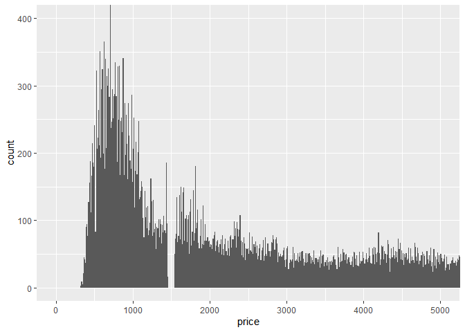<!-- -->

    ## Warning: Removed 14714 rows containing non-finite outside the scale range
    ## (`stat_bin()`).

    ## Warning: Removed 1 row containing missing values or values outside the scale range
    ## (`geom_bar()`).

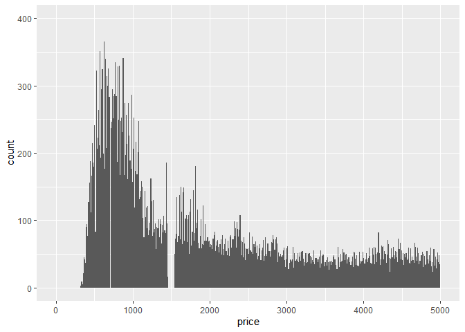<!-- -->

Looking at default bindwidth

    ## `stat_bin()` using `bins = 30`. Pick better value `binwidth`.

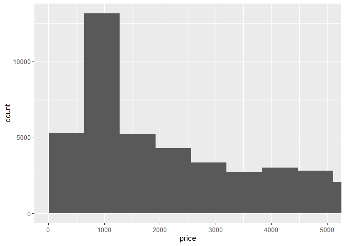<!-- -->

    ## `stat_bin()` using `bins = 30`. Pick better value `binwidth`.

    ## Warning: Removed 14714 rows containing non-finite outside the scale range
    ## (`stat_bin()`).

    ## Warning: Removed 2 rows containing missing values or values outside the scale range
    ## (`geom_bar()`).

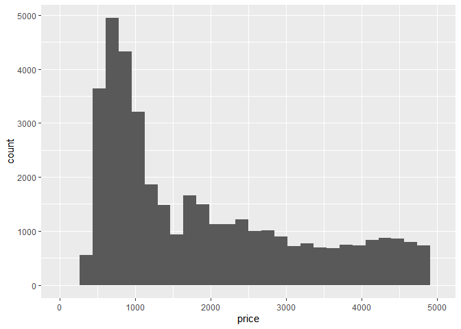<!-- -->

### **What happens if you leave binwidth unset? What happens if you try and zoom so only half a bar shows?**

For the first two graphs we see that adding x and y limits actually gets rid of the data outside of the range, which would affect its distribution and future analysis. We can zoom in to only see half the bar that goes past 400 using either coord-cartesian or y limit. Coord-cartesian does not eliminate that bar, but y limit does. If we try to leave binwidth unset, it uses a default of bins=30. If we use a x limit it calculates bins using the restricted range.

## **10.4.1 Exercises**

### **Exercise 1) What happens to missing values in a histogram? What happens to missing values in a bar chart? Why is there a difference in how missing values are handled in histograms and bar charts?**

After creating NA rows for the column y and cut, I plotted the graphs. The two histograms are before and after Na’s were added. As can be seen the histogram does not use the NAs for the distribution, there are no such bars since its not numeric. Assuming the bar chart is categorical(which for the most part should be), it just creates a new bar for the NA values. Just counts it as a separate group. Its different because one is continious while the other is categorical.

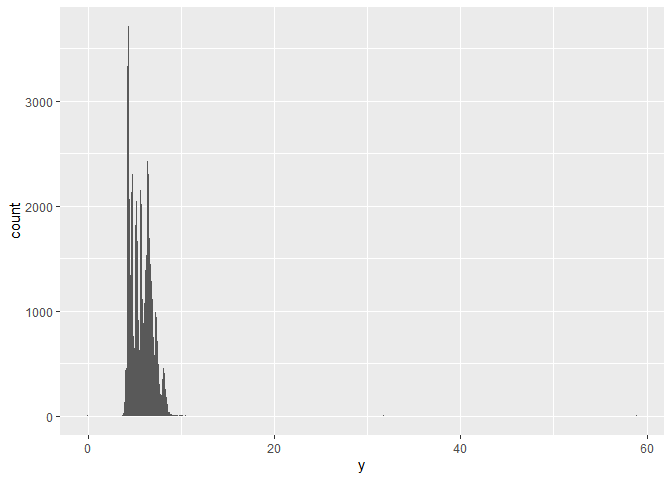<!-- -->

    ## Warning: Removed 9 rows containing non-finite outside the scale range
    ## (`stat_bin()`).

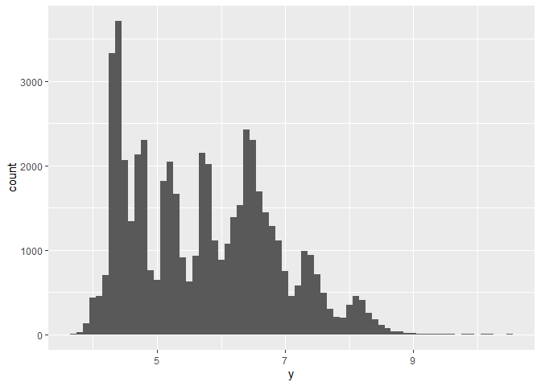<!-- -->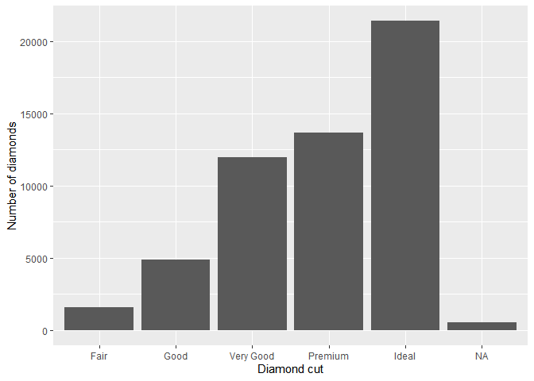<!-- -->

### **Exercise 2) What does na.rm = TRUE do in mean() and sum()?**

As can be seen in the mean and sum outputs below, the na.rm=TRUE tells mean() and sum() to skip the missing values when calculating their respective values.

    ## [1] NA

    ## [1] 5.733801

    ## [1] NA

    ## [1] 309229.6

### **Exercise 3) Recreate the frequency plot of scheduled_dep_time colored by whether the flight was cancelled or not. Also facet by the cancelled variable. Experiment with different values of the scales variable in the faceting function to mitigate the effect of more non-cancelled flights than cancelled flights.**

Using scales = “free_y” gave each panel its own y-axis, making the pattern for cancelled flights easier to see. Both groups had their highest count around 3 p.m., and cancelled flights showed several smaller peaks later in the afternoon and evening. Because the panels use different y-axis scales, I read the axis labels to compare actual counts. Its not as easy to compare them to each other without looking at the axis, but it helps spot trends within their owb group.

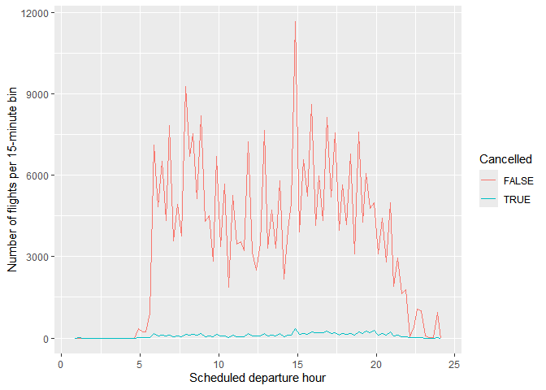<!-- -->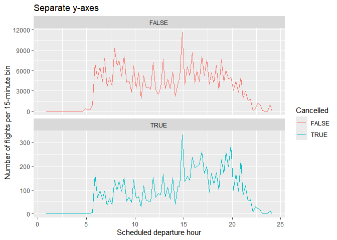<!-- -->
